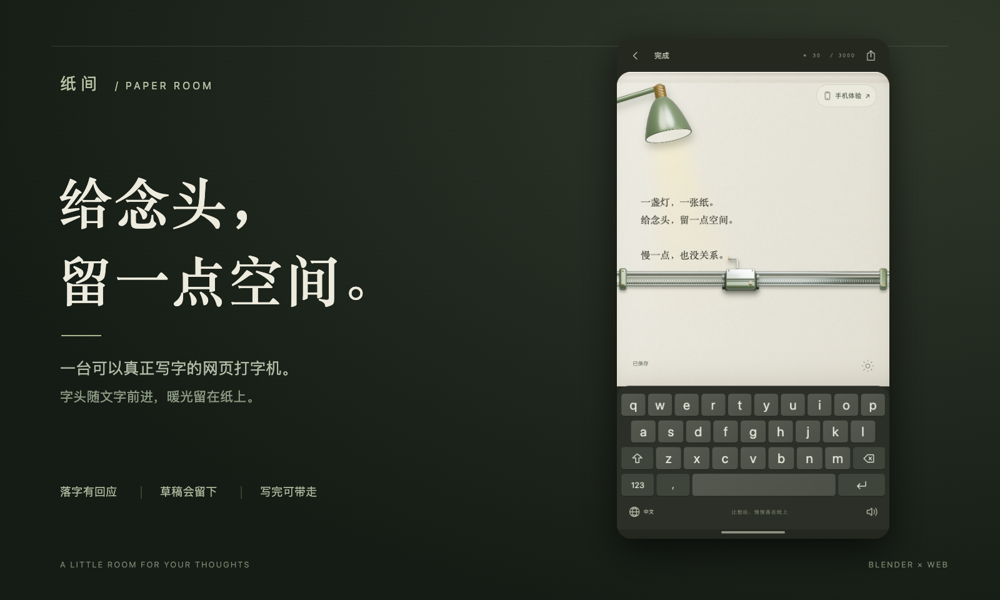
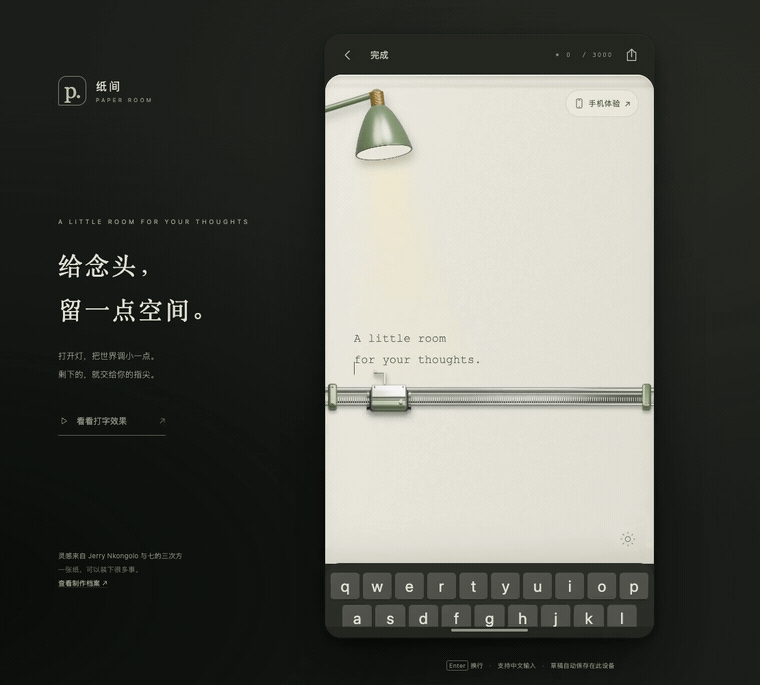

# 纸间 · Paper Room

<p align="center">
  
</p>

**一台可以真正写字的网页打字机。**

落字，字头沿着导轨前进；回车，纸面向上送进一行。绿色灯头随着输入位置缓缓转向，把暖光留在纸上。

[开始写字 ↗](https://typewriter.paws.rodeo/) · [在手机上打开](https://typewriter.paws.rodeo/mobile) · [看看它怎么做出来](https://typewriter.paws.rodeo/archive)

## 看它写一小段

<p align="center">
  
</p>

[观看或下载完整 MP4](docs/readme/paper-room-demo.mp4) · 约 23 秒，展示打字、换行、灯光开关、收起键盘与导出文字。上方 GIF 是打字片段。

## 一张纸，慢慢写

- **落字有回应。** 字头跟随光标，回车时回到行首；电脑键盘与屏幕按键都能输入，打字音效可随手关闭。
- **留一盏灯。** 灯臂固定，灯头独立转向，暖光落在纸面上。点一下灯罩，就能开关。
- **写完，把这一页带走。** 草稿自动保存在当前浏览器，可导出为 UTF-8 文本。点击「完成」，收起屏幕键盘，读一读刚写下的内容。

打开页面，轻点纸张即可开始。电脑可直接使用中文输入法；点击「中文」可切换到系统键盘。每页最多 3000 个字符。

草稿不跨设备同步，重要文字请及时导出。桌面页面的「手机体验」提供二维码与直达链接，手机和电脑各自保留草稿。

## 纸面背后的机械

<p align="center">
  
</p>

灯罩、黄铜接头、导轨和滑块由 Blender 建模，从同一机位分层渲染。灯头准备了七个角度，各有亮灯与熄灯状态；网页根据输入位置选择画面，再补上小幅转动。

文字编辑使用浏览器原生 `textarea`。镜像文字层测出折行后的光标位置，带动字头、送纸与灯光。

[机械场景](blender/build-scene.py) · [输入联动](public/app.js) · [灯光实现](public/lamp.js) · [图层清单](public/assets/manifest.json)

## 本地运行

需要 **Node.js 22 或更新版本**：

```sh
npm ci
npm run dev
```

打开终端显示的本地地址即可写字。开发服务也支持 `/mobile` 路由；网页所需的 HTML、CSS、JavaScript 与 WebP 素材均在 `public/` 中。

<details>
<summary>重新生成 Blender 场景与素材</summary>

网页运行无需 Blender。若需重建场景与透明 PNG，可使用 Blender 4.5 LTS：

```sh
blender --background --python blender/build-scene.py
blender --background --python blender/build-scene.py -- --render
```

生成结果写入 `blender/generated/`。替换网页素材时，将 PNG 转为 WebP，并同步更新 `public/assets/`。

[资源导出脚本](blender/render-assets.py) · [二维码生成脚本](scripts/generate-mobile-qr.mjs)

</details>

[部署说明](DEPLOYMENT.md) · [README 素材与采集说明](docs/readme/SOURCES.md)

## 制作档案与灵感

从 22 秒原片提取 12 个观察节点，再拆解构图、机械部件和交互。制作档案保留了编辑态与阅读态的原片、成品对照。

[查看制作档案](https://typewriter.paws.rodeo/archive) · [查看原片拆解](https://typewriter.paws.rodeo/breakdown/)

参考七的三次方的公开视频，其中提及 Jerry Nkongolo 的创作灵感。本项目独立制作机械几何、材质与网页交互，原片帧用于研究对照。[原视频](https://www.douyin.com/video/7697547042670791962)

已保留桌面浏览器和窄屏视口的输入、中文组合、灯光、草稿恢复与文本导出记录。手机原生输入法的真机验收仍待完成；具体范围见[验证与发布记录](DEPLOYMENT.md)及[本次媒体核验](docs/readme/SOURCES.md)。
