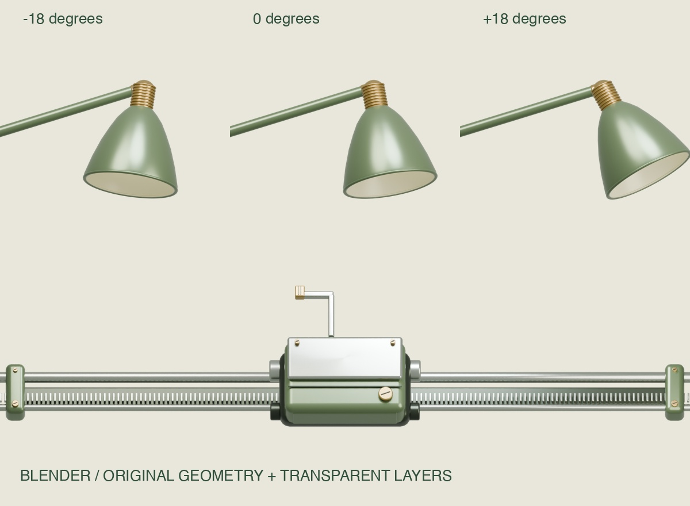

# 纸间 · Paper Room

**给念头，留一点空间。**

一台可以真正写字的网页打字机。字头跟着光标走，回车送纸，绿色台灯把暖光留在纸上。

[开始写字 ↗](https://typewriter.paws.rodeo/) · [手机体验](https://typewriter.paws.rodeo/mobile)

https://github.com/user-attachments/assets/098d8e58-4f18-4baa-91e8-f3444cb3b28e

## 写下这一页

轻点纸面即可开始，支持电脑键盘与屏幕按键。电脑可直接使用中文输入法；点击「中文」可切换到系统键盘。

点击灯罩开关台灯，点击「完成」收起键盘。写完后，点右上角的导出按钮，把这一页保存为 UTF-8 文本。

每页最多 3000 个字符。草稿保存在当前浏览器，不跨设备同步；重要文字请及时导出。

## 本地运行

需要 Node.js 22 或更新版本：

```sh
npm ci
npm run dev
```

打开终端显示的地址即可写字。运行网页无需 Blender，现成素材已包含在 `public/` 中。

<details>
<summary>制作原理与 Blender 源文件</summary>

文字编辑使用原生 `textarea`。镜像文字层测出光标位置，带动字头、纸面与灯光。

灯罩、黄铜接头、导轨与滑块由 Blender 建模并分层渲染。灯臂固定，灯头独立转向；七个角度各自包含亮灯与熄灯状态。



[输入联动](public/app.js) · [灯光实现](public/lamp.js) · [图层清单](public/assets/manifest.json)

使用 Blender 4.5 LTS 重建场景与透明 PNG：

```sh
blender --background --python blender/build-scene.py
blender --background --python blender/build-scene.py -- --render
```

输出位于 `blender/generated/`。替换网页素材时，将 PNG 转为 WebP，并同步更新 `public/assets/`。

[建模脚本](blender/build-scene.py) · [资源导出](blender/render-assets.py) · [部署说明](DEPLOYMENT.md)

</details>

## 制作与来源

参考七的三次方的公开视频，其中提及 Jerry Nkongolo 的创作灵感。本项目独立制作机械几何、材质与网页交互，原片帧用于研究对照。

[制作档案](https://typewriter.paws.rodeo/archive) · [原片拆解](https://typewriter.paws.rodeo/breakdown/) · [原视频](https://www.douyin.com/video/7697547042670791962)

[素材与验证记录](docs/readme/SOURCES.md)；手机原生输入法的真机验收仍待完成。
