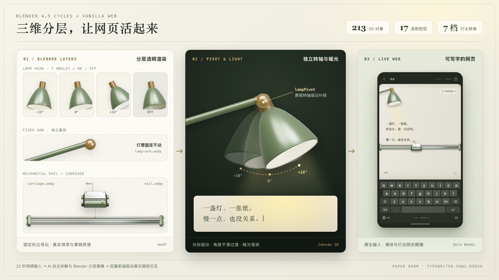

<p align="center">
  
</p>

# 纸间 · Paper Room

**给念头，留一点空间。**

一台可以真正写字的网页打字机——用 **Blender 4.5 分层渲染** 做出烤漆、黄铜与金属的真实器物感，再用 **轻量前端** 驱动滑块跟字、灯头转向与纸面暖光。

同时是一次 **Video-to-Repo** 端到端探索：输入一段 22 秒灵感视频，让 AI 在无人中途干预下自主完成拆解、3D 建模渲染与网页交付，产出独立可运行的代码仓库。

[视频拆解报告 V2 ↗](https://typewriter.paws.rodeo/) · [开发者复现教程 V6](https://typewriter.paws.rodeo/tutorial.html) · [开始写字](https://typewriter.paws.rodeo/demo/) · [手机直达](https://typewriter.paws.rodeo/mobile) · [制作档案](https://typewriter.paws.rodeo/archive) · [原片逐帧拆解](https://typewriter.paws.rodeo/breakdown/)

## 已认可报告

正式首页现为视频拆解报告 V2，另有开发者复现教程 V6，分别说明怎样理解原片，以及怎样用 Blender 与 Web 逐步复现。报告保留原认可正文与内嵌图片，发布版仅接通站内导航和效果链接。原打字机体验在 `/demo/`，`/mobile` 继续提供手机入口。

- [视频拆解报告 V2](public/index.html)：12 个截图节点、选帧依据与画面提取内容。
- [开发者复现教程 V6](public/tutorial.html)：8 个步骤，支持 Human / Agent 阅读切换，含制作源码。

## 实机演示

https://github.com/user-attachments/assets/098d8e58-4f18-4baa-91e8-f3444cb3b28e

## 核心工艺：Blender 分层渲染 × 网页交互

<p align="center">
  
</p>

- **为什么多一步 Blender？** 纯前端 / SVG 画不出真实的烤漆厚度与金属高光，直接 AI 生图又控不住连续角度和物理联动；固定机位分层渲染兼得 **3D 器物感** 与 **零 WebGL 的轻快加载**。
- **静态素材怎么动起来？** 底层保留原生 `textarea`（完整支持中文输入法、选字与粘贴），镜像层实时测算折行光标，同步驱动滑块走纸、Web Audio 键击声，以及灯头绕黄铜转轴平滑补帧与纸面暖光。
- **可复用的交互思路。** 这套「3D 建模 → 分层多状态透明渲染 → 前端锚点连续驱动」机制，同样适用于拉开窗户、推拉抽屉、拨动机械开关等器物级网页交互。

| 核心模块 | 负责内容 | 源码 |
|---|---|---|
| 输入与机械联动 | 原生 `textarea`、镜像层测光标、滑块走纸、合成音效与草稿 | [`public/app.js`](public/app.js) |
| 独立转轴与暖光 | 7 档渲染角度匹配、绕 `lampPivot` 补转、Canvas 柔和光锥 | [`public/lamp.js`](public/lamp.js) |
| Blender 建模与渲染 | 213 个原创 3D 对象与 Cycles 17 张透明分层导出 | [`blender/build-scene.py`](blender/build-scene.py) · [`blender/render-assets.py`](blender/render-assets.py) |
| 图层与枢轴清单 | 分层尺寸、灯头转轴与灯口投影坐标 | [`public/assets/manifest.json`](public/assets/manifest.json) |

## 操作速览

| 操作 | 效果 |
|---|---|
| 轻点纸面 / 敲击键盘 | 开始写作，支持电脑物理键盘与屏幕按键 |
| 点击屏幕左下角「中文」 | 切换至系统输入法输入中文 |
| `Enter` / 方向键 | 自动送纸并滑块回行首；移动光标时字头与台灯同步跟随 |
| 点击灯罩 / 太阳图标 | 开关台灯（同步切换灯罩内壁与暖光，不丢输入焦点） |
| 点击「完成」 / 导出 | 收起键盘进入阅读态，或将本页导出为 UTF-8 `.txt` |
| 点击「手机体验」 | 桌面端扫码直达全屏手机版 |

## 本地运行

需要 Node.js 22+（无需安装 Blender，现成 WebP 分层素材已在 `public/` 中）：

```sh
npm ci
npm run dev
```

<details>
<summary>使用 Blender 4.5 LTS 重建 3D 场景与透明素材</summary>

```sh
blender --background --python blender/build-scene.py
blender --background --python blender/build-scene.py -- --render
```

输出写入 `blender/generated/`；替换网页素材时将 PNG 转为 WebP 并同步更新 `public/assets/`。发布说明见 [DEPLOYMENT.md](DEPLOYMENT.md)。

</details>

## 制作档案与说明

- **完整记录**：从 22 秒视频拆解到 7 项任务落地的双状态对照见 [在线制作档案](https://typewriter.paws.rodeo/archive) 与 [12 节点原片拆解](https://typewriter.paws.rodeo/breakdown/)。
- **使用边界**：单页最多 3000 字，草稿仅存在当前浏览器本地，重要文字请及时导出；手机原生输入法的真机验收仍待完成。
- **灵感致敬**：参考七的三次方[公开视频](https://www.douyin.com/video/7697547042670791962)（提及 Jerry Nkongolo 的创作灵感）；本项目机械几何、材质与网页交互均为独立原创实现。[素材与核验记录](docs/readme/SOURCES.md)
